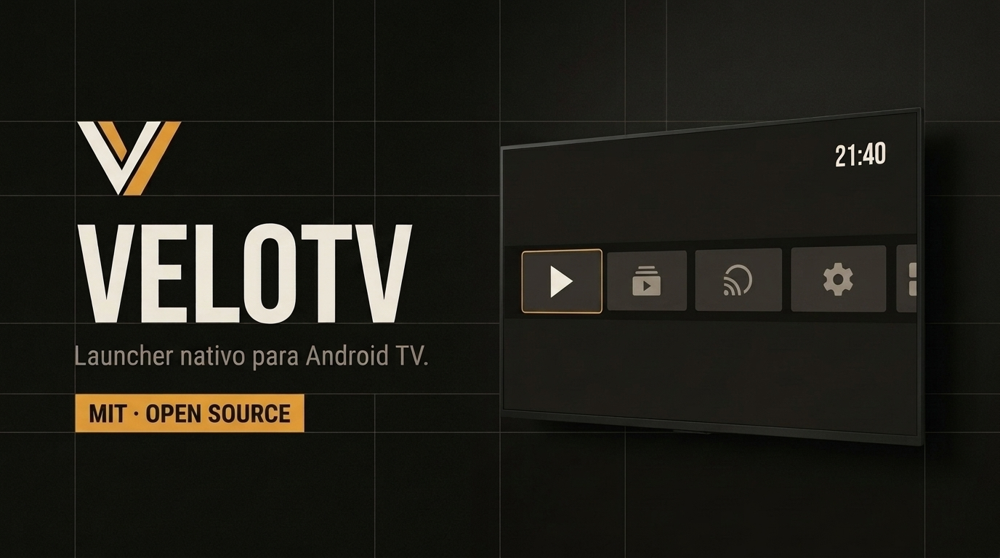
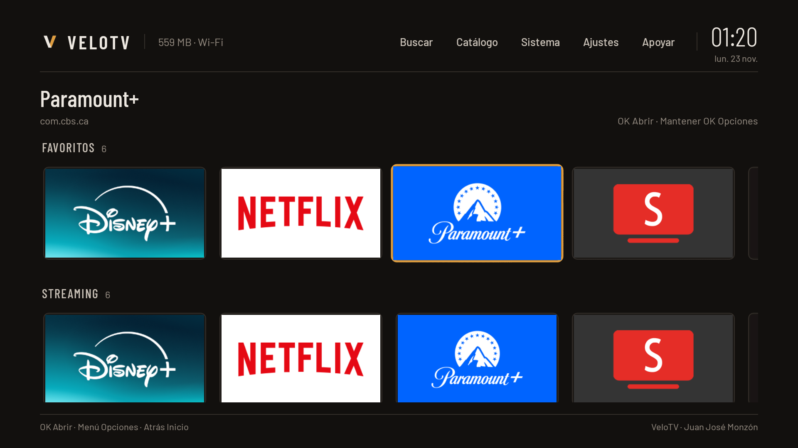
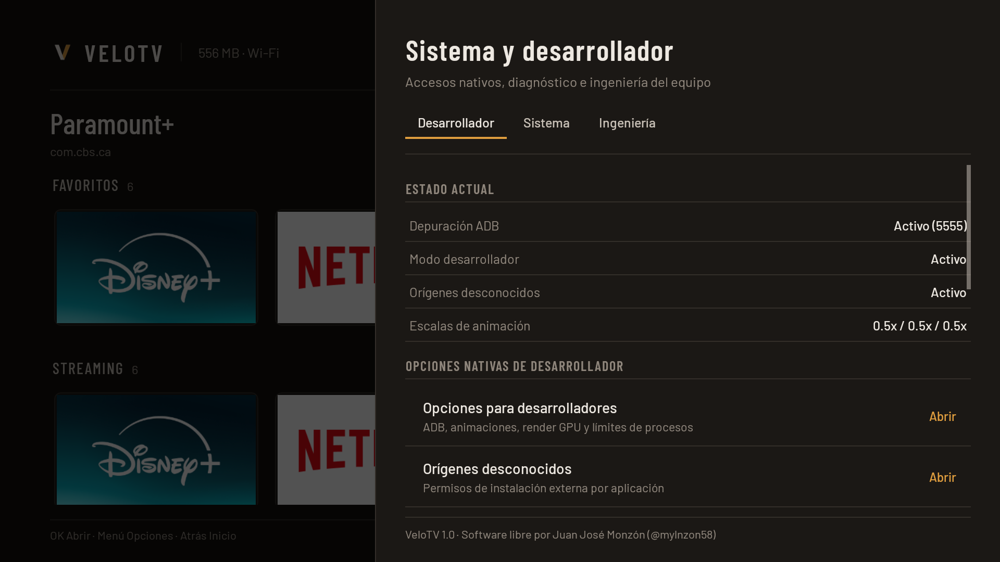
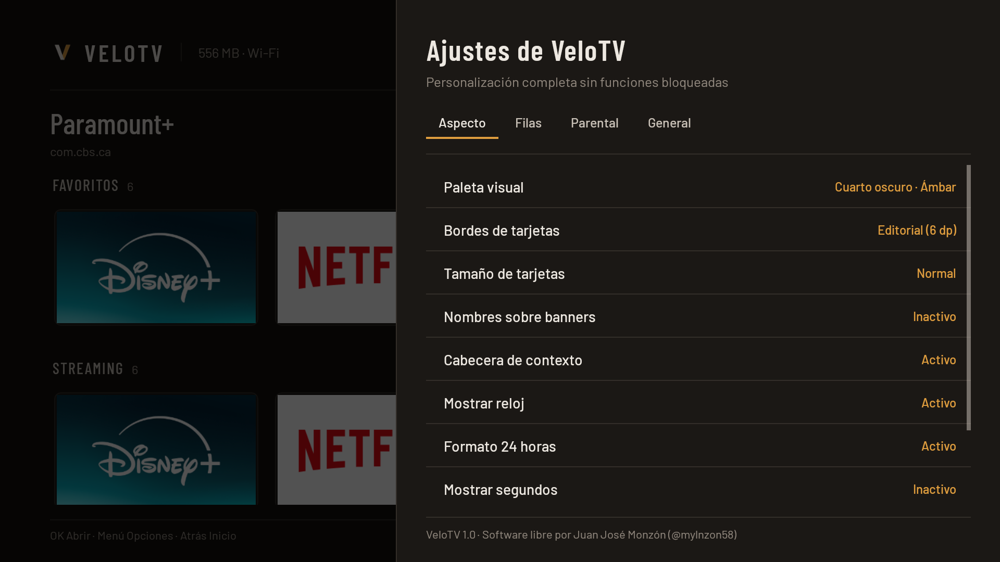
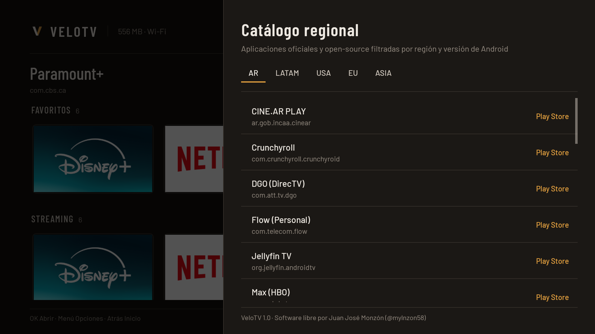
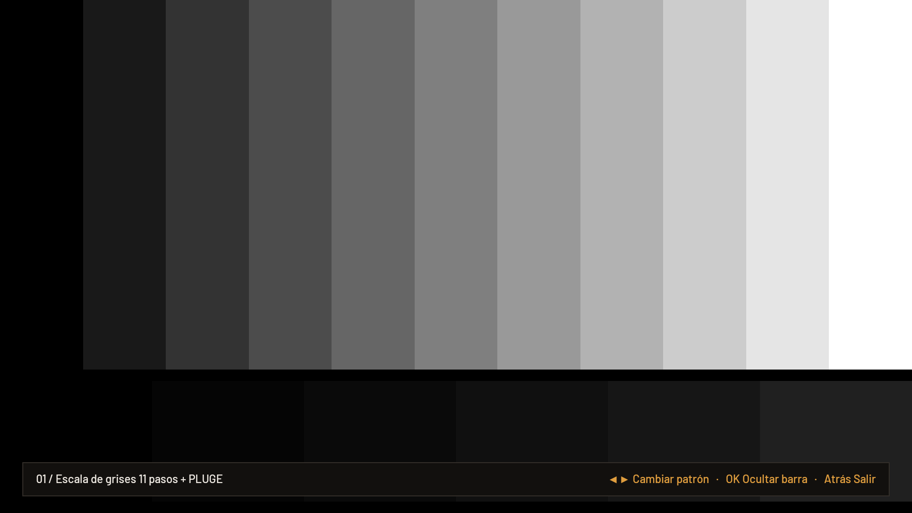
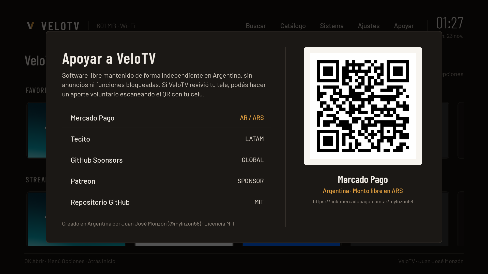

<p align="center">
  
</p>

<p align="center">
  <a href="README.md"></a>
  
  
  
  
  <a href="LICENSE"></a>
</p>

# VeloTV

Native Kotlin launcher for Android TV and Google TV engineered for steady 60 fps responsiveness on 1–2 GB RAM hardware, with no ads, no paywalls, and no `INTERNET` permission.

Benchmarked on real hardware (**Skyworth G6 / `9K02B` board / MediaTek MT5891 / 32-bit ARMv7 / Mali-T860 / 2 GB RAM / Android 8.0**) and compatible with Android TV / Google TV devices from API 24 to API 35.

---

## Real Hardware Benchmark (Skyworth MT5891 · 2 GB RAM)

Measured via `adb shell dumpsys meminfo` on the same physical television:

| Metric | Google TV Launcher + Recs | Projectivy Launcher 4.74 | **VeloTV 1.0** |
|---|---:|---:|---:|
| **Release APK Size** | ~82 MB | 11.0 MB | **1.2 MB** *(includes 5 OFL Barlow fonts)* |
| **Live RAM (PSS)** | 92.6 MB | 36.8 MB | **21.1 MB** |
| **Ads & Sponsored Rows** | Yes | No | **No** |
| **Paywalls** | N/A | Freemium | **None (MIT)** |
| **`INTERNET` Permission** | Yes | Yes | **Not declared (0 sockets verified)** |
| **Open Source** | No | No | **Yes (Native Kotlin)** |

---

## Live TV Screenshots

| Home (Darkroom Amber Palette) | System & Native Developer Drawer |
|---|---|
|  |  |

| Tabbed Settings Drawer | Regional Catalog (AR · LATAM · US · EU · ASIA) |
|---|---|
|  |  |

| 4K / HDR Display Calibration | Offline QR Creator Support |
|---|---|
|  |  |

---

## Feature Overview

- **60 fps Native Rendering:** Kotlin + native Android Views + `RecyclerView` (`DiffUtil`) + bounded 6 MB LRU bitmap cache + bundled `Barlow Condensed` and `Barlow` fonts (OFL).
- **Six Calibrated Palettes (All Free):** Darkroom Amber, Darkroom Red, Midnight, Studio Daylight, Mineral Forest, and Graphite Monochrome; three corner styles (`0 dp`, `6 dp`, `12 dp`) and three card densities.
- **Full App, Input & Row Control:** Discovers Leanback TV and sideloaded mobile apps, live search, user-created custom categories, row reordering and hiding, custom renaming for apps and HDMI inputs, and boot auto-launch.
- **Real TV & HDMI Inputs (`TvInputManager`):** Launches physical `HDMI`, `Tuner`, and `AV` sources across brands.
- **System & Native Developer Hub:** Live readout of ADB state, developer mode, unknown sources, animation scales, SoC, kernel, WebView, local IP, and RAM; plus dynamically resolved shortcuts to native Android TV Settings (Developer Options, Unknown Sources, Network, Bluetooth, Sound, Apps, Storage, Privacy, Security, Language, Keyboard, Captions, Accessibility, and OEM menus when present).
- **Built-in Display Tools:** 10 native 4K/HDR calibration patterns (11-step PLUGE grayscale, SMPTE bars, 5%/10% overscan grid, uniformity and dead-pixel checks, 3-meter sharpness test) and an OLED ambient clock with 60-second burn-in pixel shift.
- **Parental Controls & Schedule:** 4-digit PIN hashed with salted SHA-256 (constant-time verify) protecting Settings, Developer Hub, apps, or HDMI inputs, with optional scheduled restrictions.
- **10 Languages & Regional Catalog:** Spanish default plus instant switching across `es-AR`, `es`, `en`, `pt-BR`, `fr`, `de`, `it`, `ja`, `ko`, `zh-CN`, and SDK-aware regional recommendations for AR, LATAM, USA, Europe, and Asia.
- **Offline Privacy Guarantee:** Zero `INTERNET` permission in `AndroidManifest.xml`, `allowBackup="false"`, `usesCleartextTraffic="false"`, enforced by automated CI check.

---

## Build & Install

```bash
# Run unit tests & build release APK (JDK 17 + Android SDK 35)
./gradlew testDebugUnitTest assembleRelease

# Optional ADB optimization & reversible rollback toolkit
./tools/tv-toolkit/optimize_tv.sh <TV_IP>:5555 release/VeloTV-v1.0.0-universal.apk
./tools/tv-toolkit/restore_tv.sh <TV_IP>:5555
./tools/tv-toolkit/harden_close_adb.sh <TV_IP>:5555
```

---

## Author & Support

Created and maintained by **[Juan José Monzón](https://github.com/mylnzon58)** (`@mylnzon58`) in Argentina under the [MIT License](LICENSE).

| Region | Platform | Link |
|---|---|---|
| Argentina (ARS) | Mercado Pago | [link.mercadopago.com.ar/mylnzon58](https://link.mercadopago.com.ar/mylnzon58) |
| Argentina / LATAM | Tecito | [tecito.app/juanjoclassic](https://tecito.app/juanjoclassic) |
| Global (US / EU / Asia) | GitHub Sponsors | [github.com/sponsors/mylnzon58](https://github.com/sponsors/mylnzon58) |
| Monthly Sponsors | Patreon | [patreon.com/JuanjoClassic](https://www.patreon.com/JuanjoClassic) |

