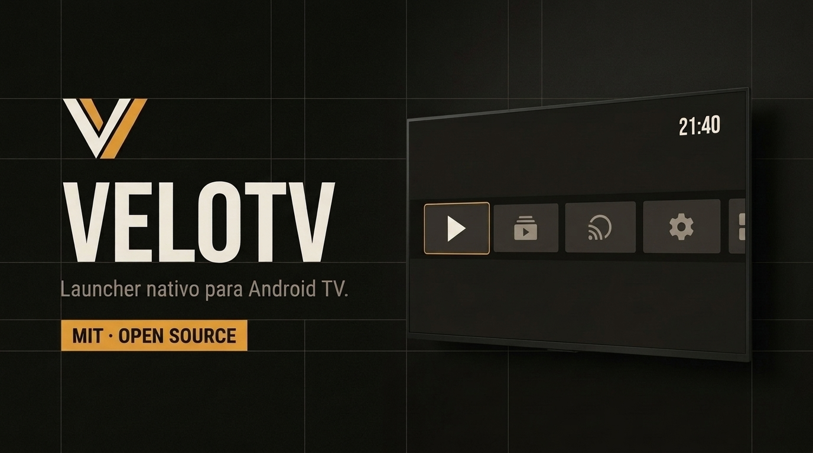
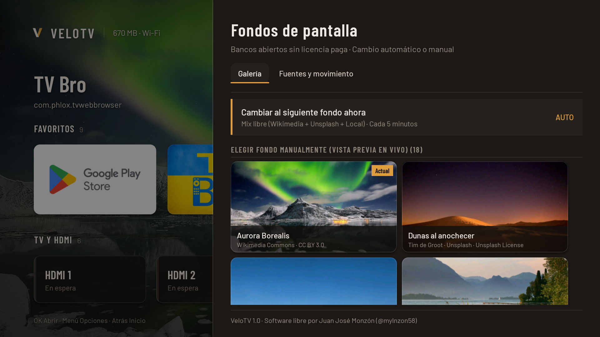
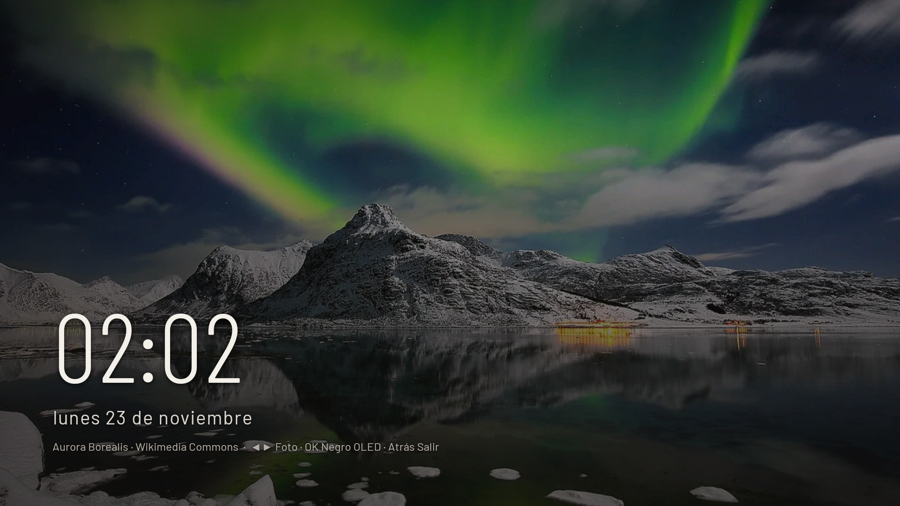
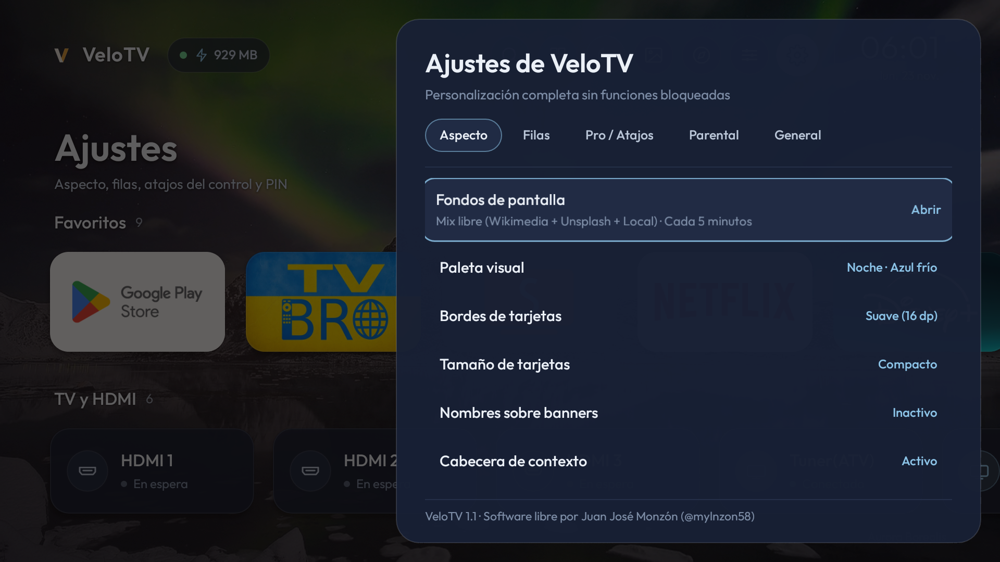
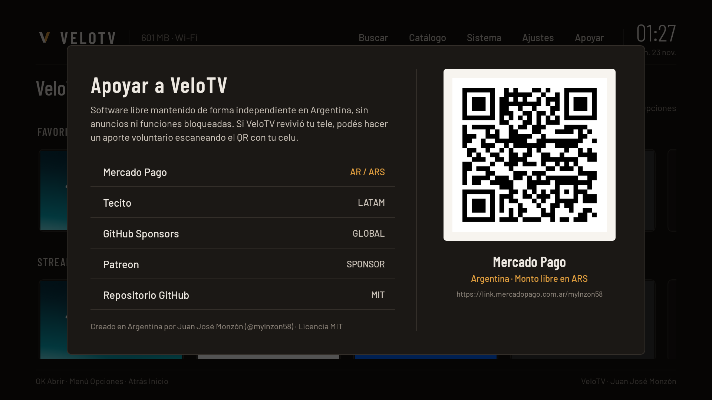

<p align="center">
  
</p>

<p align="center">
  <a href="https://mylnzon58.github.io/velotv/"></a>
  <a href="README.en.md"></a>
  
  
  
  
  <a href="LICENSE"></a>
</p>

# VeloTV

Launcher nativo en Kotlin para Android TV y Google TV diseñado para correr con fluidez de 60 fps en televisores de 1 a 2 GB de RAM, con fondos de pantalla de bancos abiertos en rotación automática, física de enfoque Material 3, brillo ambiental dinámico, cero publicidad y cero telemetría.

Probado y medido en hardware real (**Skyworth G6 / placa `9K02B` / MediaTek MT5891 / ARMv7 32-bit / Mali-T860 / 2 GB RAM / Android 8.0**) y compatible con cualquier Android TV o Google TV (API 24 a 35).

---

## Medición real en hardware (Skyworth MT5891 · 2 GB RAM)

Valores obtenidos con `adb shell dumpsys meminfo` en el mismo televisor físico:

| Métrica | Google TV Launcher + Recs | Projectivy Launcher 4.74 | **VeloTV 1.0** |
|---|---:|---:|---:|
| **Tamaño del APK** | ~82 MB | 11.0 MB | **2.1 MB** *(5 fuentes Barlow OFL + 8 fondos HD WebP)* |
| **Memoria RAM (PSS)** | 92.6 MB | 36.8 MB | **27.3 MB** *(con fondo HD + brillo ambiental · 21.1 MB modo sólido)* |
| **Fondos libres rotativos** | No | Parcial (Pro pago) | **Sí, 100% gratis (Wikimedia + Unsplash + Local)** |
| **Publicidad / Filas patrocinadas** | Sí | No | **No** |
| **Funciones de pago** | N/A | Freemium | **Ninguna (MIT)** |
| **Telemetría / Analítica** | Sí | Sí | **Cero (allowlist HTTPS solo para fondos + modo offline)** |
| **Código abierto** | No | No | **Sí (Kotlin nativo)** |

---

## Capturas reales del televisor

| Inicio con fondo libre rotativo y brillo ambiental | Galería de fondos libres con vista previa en vivo |
|---|---|
|  |  |

| Galería ambiente y reloj OLED anti-quemado | Panel de Sistema y Desarrollador |
|---|---|
|  |  |

| Ajustes completos por pestañas | Catálogo regional (AR · LATAM · US · EU · ASIA) |
|---|---|
|  |  |

| Patrones de calibración 4K / HDR | Aportes voluntarios por QR offline |
|---|---|
|  |  |

---

## Funcionalidades

- **Motor de fondos libres en baja memoria (`RGB_565` · 1.84 MB RAM):** cambia automáticamente cada 5 minutos por defecto (configurable: `1m / 5m / 15m / 30m / al volver / manual`) combinando **8 paisajes libres integrados** para arranque instantáneo en `0 ms` + bancos abiertos en vivo (**Wikimedia Commons Featured Pictures** y **Unsplash / Picsum**), galería visual con vista previa en tiempo real al mover el foco, velo cinematográfico regulable, movimiento suave tipo cámara y **modo 100% sin conexión**.
- **Fluidez real de 60 fps en 1–2 GB RAM:** Kotlin + Views nativas + pool compartido de `RecyclerView`, ruta rápida síncrona en caché LRU de 6 MB, scroll ergonómico para control remoto, elevación GPU (`translationZ`) + curva Material 3 y brillo ambiental extraído del ícono enfocado.
- **Seis paletas calibradas sin pagos:** Cuarto oscuro Ámbar, Cuarto oscuro Rojo, Noche, Estudio (claro para salas luminosas), Mineral Bosque y Grafito Monocromo; tres radios de esquina (`0 dp`, `10 dp`, `16 dp`) y tres densidades de tarjeta.
- **Gestión total de aplicaciones y filas:** detecta apps Android TV (con sus banners oficiales de actividad) y apps móviles instaladas, búsqueda instantánea, creación y eliminación de categorías personalizadas, reordenamiento y ocultamiento de filas, renombrado de apps y entradas HDMI, e inicio automático al encender.
- **Entradas físicas TV y HDMI (`TvInputManager`):** detecta `HDMI 1/2/3`, sintonizador digital/analógico y `AV`, con estado en vivo, renombrado y bloqueo por PIN.
- **Sistema, Limpieza rápida y Desarrollador:** botón **Limpiar** de 1 clic en la barra superior (libera apps inactivas en segundo plano con `ActivityManager`, vacía cachés internas y abre el caché global de Almacenamiento nativo al mantener `OK`); lectura en vivo de ADB, modo desarrollador, orígenes desconocidos, escalas de animación, SoC, kernel, WebView, IP local y RAM; más accesos directos verificados dinámicamente a las actividades nativas de Android TV y menús de hardware del fabricante.
- **Herramientas de pantalla integradas:** 10 patrones nativos de calibración 4K/HDR (grises PLUGE, barras SMPTE, overscan 5%/10%, uniformidad y píxeles muertos, nitidez a 3 m) y **Galería ambiente + reloj OLED** con desplazamiento anti-quemado cada 60 s y cambio instantáneo a negro puro OLED con `OK`.
- **Control parental con horario:** PIN de 4 dígitos almacenado con SHA-256 + salt (comparación en tiempo constante) para proteger Ajustes, Desarrollador, apps o entradas HDMI, con horario configurable.
- **Global desde el inicio:** español como idioma predeterminado + 10 idiomas seleccionables al instante (`es-AR`, `es`, `en`, `pt-BR`, `fr`, `de`, `it`, `ja`, `ko`, `zh-CN`) y catálogo regional (AR, LATAM, USA, EU, ASIA) filtrado por `SDK_INT`.
- **Seguridad OWASP y transparencia:** cero analítica, cero permisos peligrosos, `allowBackup="false"`, `usesCleartextTraffic="false"`, y allowlist estricto HTTPS verificado por pruebas unitarias ([SECURITY.md](SECURITY.md) y [CREDITS.md](CREDITS.md)).

---

## Instalación

### 1. Instalar el APK
Descarga `release/VeloTV-v1.0.0-universal.apk` (verifica su hash en `release/SHA256SUMS.txt`) e instálalo por USB, LocalSend o ADB:

```bash
adb connect <IP_DEL_TV>:5555
adb install -r release/VeloTV-v1.0.0-universal.apk
```

### 2. Optimización completa del televisor (opcional, 100% reversible)
El directorio `tools/tv-toolkit/` incluye scripts modulares para desactivar bloatware en `--user 0`, reducir escalas de animación a `0.5x`, compilar con ART `speed-profile` y revertir todo si hace falta:

```bash
./tools/tv-toolkit/optimize_tv.sh <IP_DEL_TV>:5555 release/VeloTV-v1.0.0-universal.apk
./tools/tv-toolkit/restore_tv.sh <IP_DEL_TV>:5555
./tools/tv-toolkit/harden_close_adb.sh <IP_DEL_TV>:5555
```

---

## Compilación desde código fuente

Requiere JDK 17 y Android SDK 35:

```bash
./gradlew testDebugUnitTest
./gradlew assembleRelease
```

---

## Autor, licencia y aportes

Creado y mantenido por **[Juan José Monzón](https://github.com/mylnzon58)** (`@mylnzon58`) en Argentina bajo licencia **[MIT](LICENSE)** (ver también [NOTICE](NOTICE)).

Puedes usar, estudiar, modificar y distribuir este proyecto libremente, siempre **conservando los créditos y el aviso de copyright original** en todas las copias o derivados.

| Región | Plataforma | Enlace |
|---|---|---|
| Argentina (ARS, monto libre) | Mercado Pago | [link.mercadopago.com.ar/mylnzon58](https://link.mercadopago.com.ar/mylnzon58) |
| Argentina / LATAM | Tecito | [tecito.app/juanjoclassic](https://tecito.app/juanjoclassic) |
| Internacional (US / EU / Asia) | GitHub Sponsors | [github.com/sponsors/mylnzon58](https://github.com/sponsors/mylnzon58) |
| Sponsors mensuales | Patreon | [patreon.com/JuanjoClassic](https://www.patreon.com/JuanjoClassic) |
