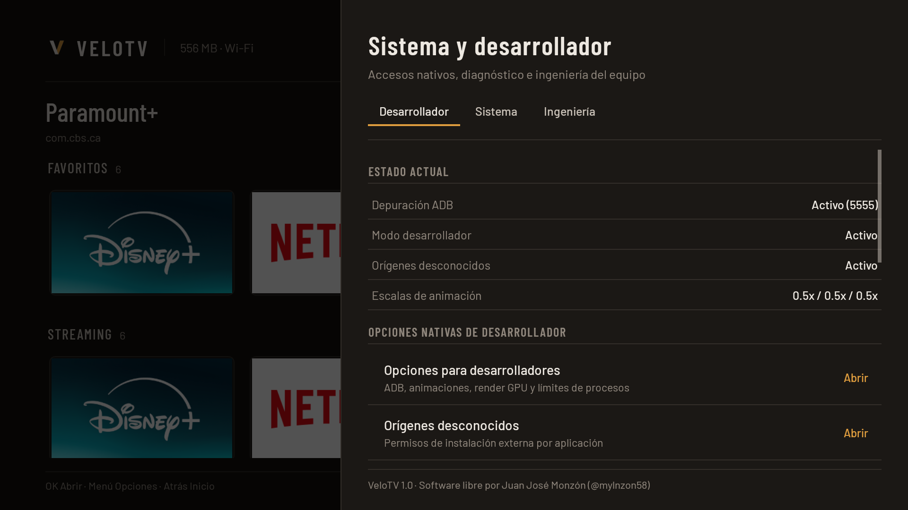
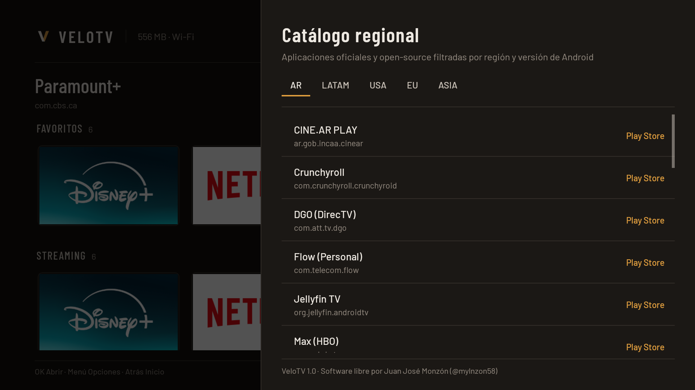

<p align="center">
  
</p>

<p align="center">
  <a href="README.en.md"></a>
  
  
  
  
  <a href="LICENSE"></a>
</p>

# VeloTV

Launcher nativo en Kotlin para Android TV y Google TV diseñado para responder a 60 fps en televisores de 1 a 2 GB de RAM, sin publicidad, sin funciones bloqueadas y sin permiso `INTERNET`.

Probado en hardware real (**Skyworth G6 / placa `9K02B` / MediaTek MT5891 / ARMv7 32-bit / Mali-T860 / 2 GB RAM / Android 8.0**) y compatible con cualquier dispositivo Android TV o Google TV (API 24 a 35).

---

## Medición real en hardware (Skyworth MT5891 · 2 GB RAM)

Valores obtenidos con `adb shell dumpsys meminfo` en el mismo televisor físico:

| Métrica | Google TV Launcher + Recs | Projectivy Launcher 4.74 | **VeloTV 1.0** |
|---|---:|---:|---:|
| **Tamaño del APK** | ~82 MB | 11.0 MB | **1.2 MB** *(incluye 5 fuentes Barlow OFL)* |
| **Memoria RAM (PSS)** | 92.6 MB | 36.8 MB | **21.1 MB** |
| **Publicidad / Filas promocionales** | Sí | No | **No** |
| **Funciones de pago** | N/A | Freemium | **Ninguna (MIT)** |
| **Permiso `INTERNET`** | Sí | Sí | **No declarado (0 sockets verificados)** |
| **Código abierto** | No | No | **Sí (Kotlin nativo)** |

---

## Capturas reales del televisor

| Inicio (Paleta Cuarto oscuro · Ámbar) | Panel de Sistema y Desarrollador |
|---|---|
|  |  |

| Ajustes completos por pestañas | Catálogo regional (AR · LATAM · US · EU · ASIA) |
|---|---|
|  |  |

| Patrones de calibración 4K / HDR | Aportes voluntarios por QR offline |
|---|---|
|  |  |

---

## Funcionalidades

- **Interfaz nativa de 60 fps:** Kotlin + Views nativas + `RecyclerView` (`DiffUtil`) + caché LRU de miniaturas acotada a 6 MB + tipografía `Barlow Condensed` y `Barlow` embebida (OFL).
- **Seis paletas calibradas sin pagos:** Cuarto oscuro Ámbar, Cuarto oscuro Rojo, Noche, Estudio (claro para salas luminosas), Mineral Bosque y Grafito Monocromo; tres radios de esquina (`0 dp`, `6 dp`, `12 dp`) y tres densidades de tarjeta.
- **Gestión total de aplicaciones y filas:** detecta apps Android TV y apps móviles instaladas, búsqueda instantánea, creación y eliminación de categorías personalizadas, reordenamiento y ocultamiento de filas, renombrado de apps y entradas HDMI, e inicio automático al encender.
- **Entradas físicas TV y HDMI (`TvInputManager`):** detecta `HDMI 1/2/3`, sintonizador digital/analógico y `AV`, con renombrado personalizado y bloqueo por PIN.
- **Sistema y Opciones Nativas de Desarrollador:** lectura en vivo de ADB, modo desarrollador, orígenes desconocidos, escalas de animación, SoC, kernel, WebView, IP local y RAM; más accesos directos verificados dinámicamente a las actividades nativas de Android TV (Desarrollador, Orígenes desconocidos, Red, Bluetooth, Sonido, Aplicaciones, Almacenamiento, Privacidad, Seguridad, Idioma, Teclados, Subtítulos, Accesibilidad y menús OEM si existen).
- **Herramientas de pantalla integradas:** 10 patrones nativos de calibración 4K/HDR (grises PLUGE, barras SMPTE, overscan 5%/10%, uniformidad y píxeles muertos, nitidez a 3 m) y reloj ambiente OLED con desplazamiento anti-quemado cada 60 s.
- **Control parental con horario:** PIN de 4 dígitos almacenado con SHA-256 + salt (comparación en tiempo constante) para proteger Ajustes, Desarrollador, apps o entradas HDMI, con restricción horaria configurable.
- **Global desde el inicio:** español como idioma predeterminado + 10 idiomas seleccionables al instante (`es-AR`, `es`, `en`, `pt-BR`, `fr`, `de`, `it`, `ja`, `ko`, `zh-CN`) y catálogo regional (AR, LATAM, USA, EU, ASIA) filtrado por `SDK_INT`.
- **Privacidad verificable:** el manifiesto no declara `android.permission.INTERNET`, bloquea `allowBackup` y `usesCleartextTraffic`, y el pipeline CI falla si se agrega permiso de red.

---

## Instalación

### 1. Instalar el APK
Descarga `release/VeloTV-v1.0.0-universal.apk` (verifica su hash en `release/SHA256SUMS.txt`) e instálalo por USB, LocalSend o ADB:

```bash
adb connect <IP_DEL_TV>:5555
adb install -r release/VeloTV-v1.0.0-universal.apk
```

### 2. Optimización completa del televisor (opcional, 100% reversible)
El directorio `tools/tv-toolkit/` incluye scripts modulares para desactivar bloatware en `--user 0`, reducir escalas de animación a `0.5x`, compilar con ART `speed-profile` y revertir todo si hace falta:

```bash
./tools/tv-toolkit/optimize_tv.sh <IP_DEL_TV>:5555 release/VeloTV-v1.0.0-universal.apk
./tools/tv-toolkit/restore_tv.sh <IP_DEL_TV>:5555
./tools/tv-toolkit/harden_close_adb.sh <IP_DEL_TV>:5555
```

---

## Compilación desde código fuente

Requiere JDK 17 y Android SDK 35:

```bash
./gradlew testDebugUnitTest
./gradlew assembleRelease
```

---

## Autor y aportes

Creado y mantenido por **[Juan José Monzón](https://github.com/mylnzon58)** (`@mylnzon58`) en Argentina bajo licencia [MIT](LICENSE).

| Región | Plataforma | Enlace |
|---|---|---|
| Argentina (ARS, monto libre) | Mercado Pago | [link.mercadopago.com.ar/mylnzon58](https://link.mercadopago.com.ar/mylnzon58) |
| Argentina / LATAM | Tecito | [tecito.app/juanjoclassic](https://tecito.app/juanjoclassic) |
| Internacional (US / EU / Asia) | GitHub Sponsors | [github.com/sponsors/mylnzon58](https://github.com/sponsors/mylnzon58) |
| Sponsors mensuales | Patreon | [patreon.com/JuanjoClassic](https://www.patreon.com/JuanjoClassic) |
